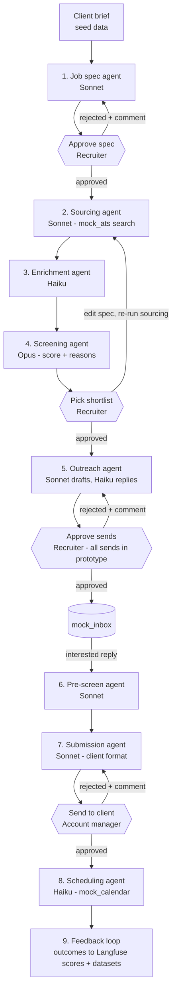
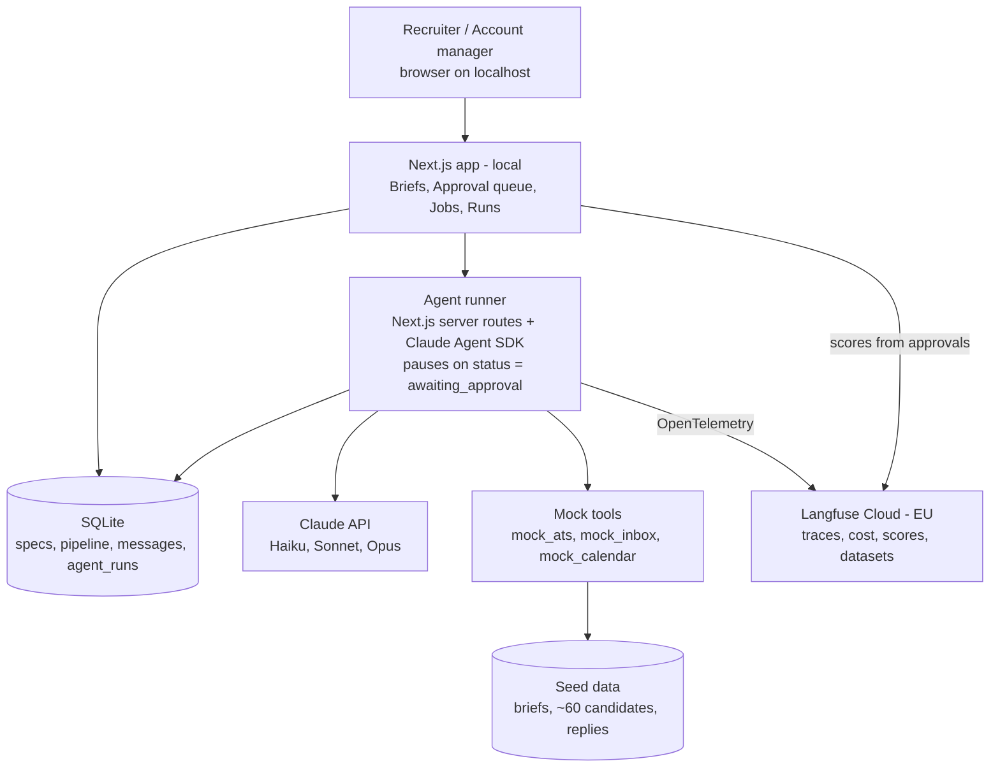

# Project: AI recruiting agents prototype for "Hireloop"

## Working style
- Explain what you're about to do in plain language before doing it.
- Ask before installing anything or creating accounts.
- Prefer simple, boring, well-known tools over clever ones.
- After each working step, say how to run and see it.
- Personal preferences can go in `CLAUDE.local.md` (git-ignored, read by Claude Code automatically).

## The imaginary company
Hireloop is a fictional IT staffing company (~30 recruiters, offices in Kyiv and Warsaw).
It places software engineers with EU and US clients. Recruiters waste time on manual sourcing,
copy-pasting profiles, and writing outreach. We're building them AI agents with human approvals.

This is a PROTOTYPE / demo. No real candidates and no real LinkedIn: candidates and clients are fictional seed data.
Real email goes only to the developer's own test inbox (and allow-listed addresses), checked in code.

## Specs (source of truth)
Each step has a full spec in `docs/specs` (`01-job-spec-agent.md` ... `09-feedback-loop.md`; later features 10-16).
`docs/specs/00-template.md` is the template.
- Before building a step, read its spec and summarize it back to me in plain language.
- Build exactly what the spec says. If something is unclear or seems wrong, ask me; don't guess.
- If we change behavior while building, update the spec file in the same change.
- Use each spec's "Acceptance criteria" as the definition of done, and its "Test cases"
  as automated tests and as the first Langfuse dataset for that agent.

## The workflow (9 steps)
Purple = Claude agent. [APPROVAL] = human must approve in the app before the flow continues.

1. Job spec agent (Sonnet): turns a messy client brief into structured JSON spec. [APPROVAL: recruiter]
2. Sourcing agent (Sonnet): writes search queries, finds candidates in the mock candidate DB, dedupes.
3. Enrichment agent (Haiku): extracts stack, tenure, location, contacts from raw profile text.
4. Screening agent (Opus): scores each candidate vs spec with written reasons. [APPROVAL: recruiter picks shortlist]
5. Outreach agent (Sonnet drafts, Haiku classifies replies): personalized messages. [APPROVAL: recruiter approves sends]
6. Pre-screen agent (Sonnet): sends questions, summarizes answers.
7. Submission agent (Sonnet): builds candidate profile in client format. [APPROVAL: account manager]
8. Scheduling agent (Haiku): proposes interview slots, nudges.
9. Feedback loop: hire/reject outcomes stored for evals and prompt improvements.

### Workflow diagram (prototype)

Agent steps without a human gate (2, 3, 6, 8) still escalate to the approval queue
when their spec's edge cases say so.

## Models
- Haiku: `claude-haiku-4-5-20251001` - cheap, high-volume extraction/classification
- Sonnet: `claude-sonnet-5-5` - default workhorse
- Opus: `claude-opus-5-5` - ranking/judgment only
Keep model names in one config file so they're easy to swap.

## Prototype tech stack (keep it local and simple)
- Next.js (TypeScript) web app = the recruiter UI, run locally
- SQLite (via Prisma or Drizzle) for the prototype database. Supabase later.
- Claude Agent SDK (TypeScript) as the agent harness
- Agents run from server routes; approvals = a `status` field (`awaiting_approval` -> `approved`)
  that pauses the pipeline until the recruiter clicks in the UI. Trigger.dev later.
- Mock tools exposed to agents as functions/MCP-style tools:
  - `mock_ats` (stands in for Ashby): jobs, candidates, pipeline stages
  - `mock_inbox` (stands in for Gmail): outbox + simulated candidate replies
  - `mock_calendar`: free/busy slots
- Observability: Langfuse (Langfuse Cloud, EU region, free tier) from Phase 0.
  - Integration: OpenTelemetry, following Langfuse's official guide
    "Trace Claude Agent SDK JS/TS with Langfuse" (langfuse.com/integrations/frameworks/claude-agent-sdk-js).
    Check that page for current package names before installing.
  - Every agent run = one Langfuse trace, named and tagged as in its spec.
  - Record the scores listed in each spec (approvals, edits, overrides) via the Langfuse SDK.
  - Also keep a small `agent_runs` table (agent, model, tokens, cost, trace_id) so the app's
    Runs page can link each run to its Langfuse trace.
- Real external dependencies: an Anthropic API key (required), Langfuse keys (optional) and a Google OAuth client
  (from step 5). Bring your own key: typed in the app's Keys menu (saved in the local database) or in `.env.local`.
  Never commit them. See `docs/specs/16-bring-your-own-key.md`.

### Architecture diagram (prototype, runs on my laptop)

Later, for a hosted demo, swap: local Next.js -> Vercel, SQLite -> Supabase Postgres,
server routes -> Trigger.dev jobs, mock tools -> real Ashby / Gmail / Calendar via MCP.
Langfuse stays the same.

## Cost budgets
- Every spec has a "Cost budget" section: budget per unit, max agent turns, and what happens when exceeded.
- Keep all budgets in one config file (`src/config/budgets.ts`) next to the model names, so I can edit them in one place.
- After every run, compare actual cost (from the Agent SDK result) to the budget:
  - above 1x: flag the run, add tag `over-budget` and score `cost_vs_budget` in Langfuse
  - above 3x or max turns hit: stop the run, save nothing, put "Stopped: over budget" in the approval queue
- Job-level budget: $1.50 for a full job (spec through scheduling, ~20 sourced candidates; lowered from $3.00
  in Phase 2). Show running cost per job on the Job page with a warning at 80%. Hard stop: at 100% the
  pipeline pauses and asks in the approval queue ("Continue" adds $1.50 to that job, or "Stop job").
- Runs page: columns for cost, budget, and % of budget; filter "over budget only";
  totals per job and per agent; each row links to its Langfuse trace.
- Budgets are starting guesses. After the first 10 runs per agent, show me actual medians
  and suggest new budgets (about 1.5x median).

## Keep it hosting-ready (applies from Phase 0)
The prototype is local, but `docs/hosting.md` describes the later hosted version. Don't build hosting now,
but follow these rules so the move is easy:
- Use an ORM (Prisma or Drizzle) so SQLite -> Postgres is a config change.
- Keep all agent-running code in one module (`src/agents`), separate from UI routes (`src/app`),
  so it can move to Trigger.dev tasks with minimal changes.
- Approvals are a database status, never in-memory state.
- No files written to local disk at runtime; everything goes in the database.
- Every key and URL comes from environment variables.
- Use git from the start; `.env.local` in `.gitignore`.

## Seed data to generate
- 3 messy client briefs (email-style, vague, with missing info)
- ~60 fictional candidate profiles (Ukrainian/Polish engineers, mixed seniority and stacks)
- A few pre-written candidate replies (interested, not interested, ask about rate, out of office)

## Screens
1. Inbox of client briefs -> "Create spec" button
2. Approval queue (everything waiting for a human, across all steps)
3. Job page showing pipeline: sourced -> shortlisted -> contacted -> replied -> submitted -> interview
4. Runs page: every agent run with cost vs budget, tokens, model, over-budget flag, totals per job/agent, and a link to its Langfuse trace

## Build phases (do one at a time, confirm with me before moving on)
- Phase 0: Project setup, seed data, empty UI shell, Langfuse connected with one test trace. Show me it runs.
- Phase 1: Job spec agent + approval queue. (Step 1 end-to-end.)
- Phase 2: Sourcing + enrichment + screening agents, shortlist approval. (Steps 2-4.)
- Phase 3: Outreach + reply handling with send approval. (Step 5.)
- Phase 4: Langfuse dashboards, scores, and datasets polish.
- Phase 5: Pre-screen, submission, scheduling, feedback. (Steps 6-9.)
- Later: move to Supabase + Vercel + Trigger.dev for a hosted demo.

## Handoff: PROGRESS.md and CHANGELOG.md
The handoff is a file, not a chat summary. At the end of every phase, update `PROGRESS.md` (a local, git-ignored
working diary; create it if it's missing) with:
- which phase is done and what works (with how to run/see it);
- decisions made and spec changes;
- known issues and anything left to do;
- the next step.
Read `PROGRESS.md` at the start of every session, if it exists, before doing anything else.
Add a short public summary of finished work to `CHANGELOG.md`.

## Code layout
- `src/app` screens (Next.js), `src/agents` all agent-running code, `src/config` models, budgets and knobs,
  `src/lib` shared helpers (database, settings), `src/evals` Langfuse datasets.
- `prompts/` agent prompts, `prisma/` schema, migrations and seed data, `scripts/` tests, evals, Langfuse, video,
  `docs/` architecture, Google setup, hosting plan and specs.
- Never commit personal data: no real email addresses (use `test.inbox+N@example.com` placeholders), names, keys or IDs.

## Rules for every agent
- Never invent facts about candidates or clients. Unknowns go into an `open_questions` field.
- Output must match a defined JSON schema; validate it (e.g. Zod) and retry once on failure.
- Every agent run gets logged to `agent_runs`.
- Prompts live in separate files under `prompts/` so they're easy to read and edit.

## Job spec JSON schema (starting point)
{
  "title": string,
  "seniority": "junior" | "middle" | "senior" | "lead" | null,
  "must_have": string[],
  "nice_to_have": string[],
  "dealbreakers": string[],
  "location": string[],
  "rate_range": string | null,
  "selling_points": string[],
  "open_questions": string[]
}
