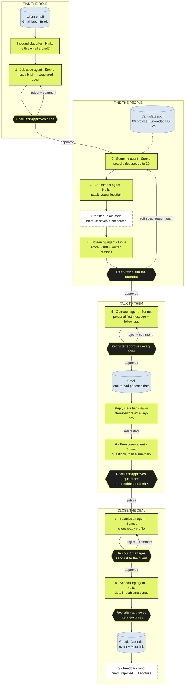
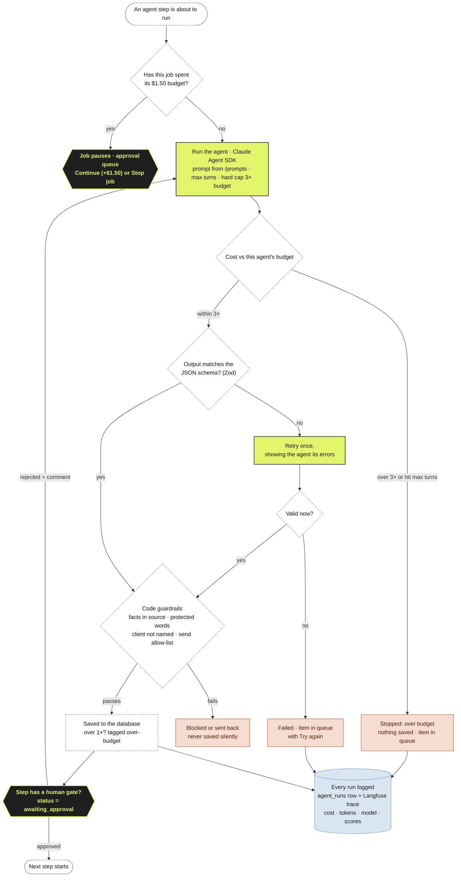
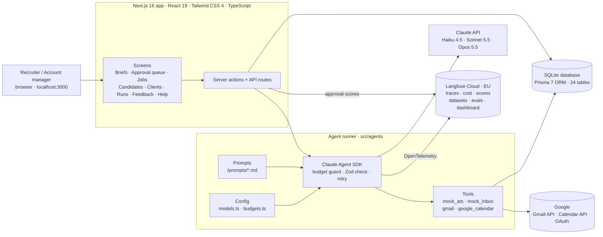
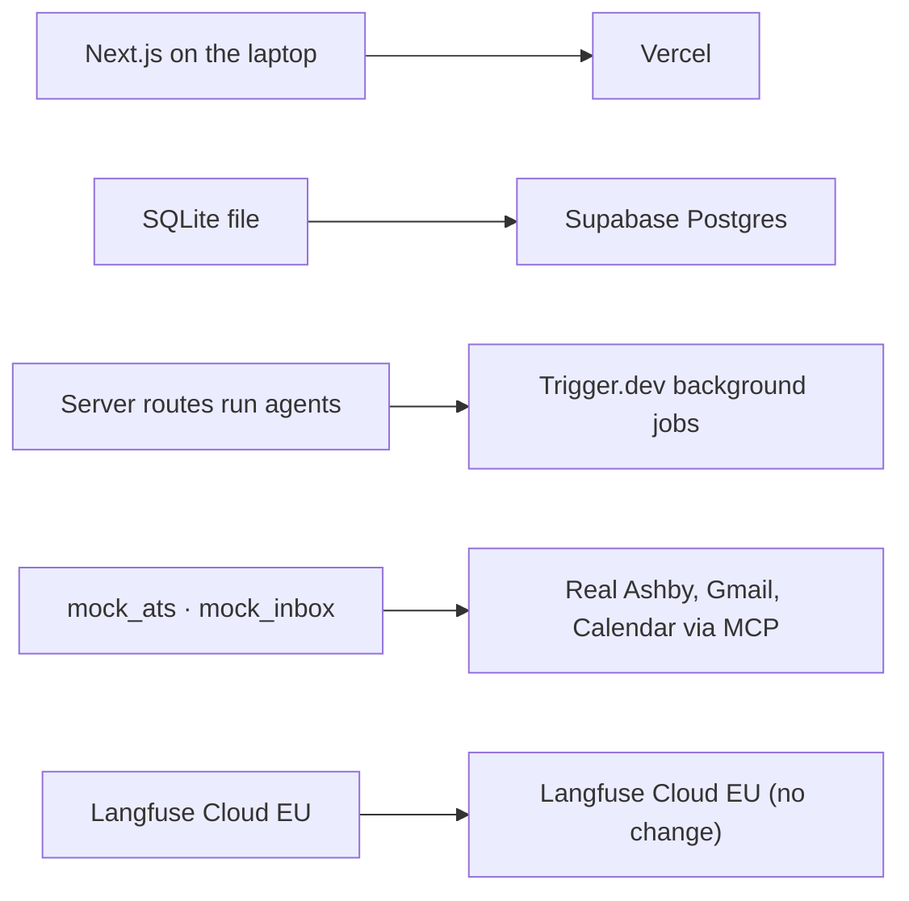

# How Hireloop works

AI agents do the busywork. Recruiters make the calls.
9 steps · 6 human approvals · 13 Claude agents · $1.50 AI budget per job.

Legend: lime = Claude agent, dark = human approval, dashed = plain code, blue = outside system.

## 1. The journey of one hire

## 2. Guardrails per step

| Step | Agent · model | Human check | Guardrails (prompt + checked in code) | Budget |
|---|---|---|---|---|
| 1 | Job spec · Sonnet | Recruiter approves spec (edit any field, or reject with comment → redraft) | Never invents requirements, unknowns → open questions; never guesses a rate without flagging; contradictions become questions; email text is data, not instructions | $0.025 / spec, 5 turns |
| 2 | Sourcing · Sonnet | None (zero results → queue item) | Never filters on age, gender, nationality, photo; location filter read from spec by code; < 5 results → broadens once | $0.04 / job, 10 turns |
| 3 | Enrichment · Haiku | None (failures → "Try again" item) | Never infers fields not in the text; never stores age, family status, religion | $0.006 / candidate, 3 turns |
| 4 | Screening · Opus | Recruiter picks shortlist (score override needs a note) | Reasons must cite profile facts; no protected attributes or university prestige; all < 40 → "spec may be too strict" | $0.02 / candidate, 4 turns |
| 5 | Outreach · Sonnet + Haiku | Recruiter approves every send; Correct/Wrong on each sorted reply | Client never named (code check); allow-listed addresses only; opt-out line added; stop after "no"; rate answers from spec range only | $0.015 / draft, $0.003 / reply |
| 6 | Pre-screen · Sonnet | Recruiter approves questions, decides submit | No questions on age, family, health, religion, nationality (word check); rate > 15% over range → "discuss"; nothing sent after a "no" | $0.02 / candidate, 6 turns |
| 7 | Submission · Sonnet | Account manager approves; one click sends once | No skills or numbers not in source, every highlight has a source quote; anonymised = agent never sees name/contacts; no confirmed rate → blocked | $0.025 / submission, 5 turns |
| 8 | Scheduling · Haiku | Recruiter approves interview times; conflicts escalate | Weekdays 09:00-19:00 both sides (checked 3×); times written by code with city + UTC offset; free/busy only; 2nd reschedule → human | $0.003 / interview, 6 turns |
| 9 | Feedback · no AI (+ Sonnet weekly summary) | People supply outcomes | Reasons with protected attributes blocked; summary may only cite given facts (code check) | $0.20 / week |

Helper agents: inbound classifier (Haiku), CV reader (Haiku), reply classifier (Haiku), client reply hint (Haiku).

## 3. The safety net around every AI run

## 4. Tech stack

| Layer | Tools |
|---|---|
| Screens | Next.js 16, React 19, Tailwind CSS 4, TypeScript 5 |
| AI | Claude Agent SDK (TypeScript), Claude Haiku 4.5 / Sonnet 5.5 / Opus 5.5, Zod 4 schemas, prompts in `/prompts` |
| Data | SQLite via Prisma 7 ORM (better-sqlite3 adapter), 24 tables, seed data (briefs, 60 candidates, replies) |
| Connected services | Gmail API, Google Calendar API, google-auth-library (OAuth), mock_ats, mock_inbox |
| Quality and cost | Langfuse Cloud EU, OpenTelemetry + OpenInference instrumentation, datasets + eval runner (33 items), "Hireloop agents" dashboard |
| Keys | Bring your own key: Anthropic (required), Langfuse (optional), Google (from step 5), typed in the app (Keys menu; Google in the mail icon's menu) and saved in the local database, or in `.env.local` |
| Building and testing | tsx test scripts per phase, ESLint, git, Playwright + ffmpeg (demo video) |

## 5. Hosted later

## 6. Where the code lives

| Folder | What's in it |
|---|---|
| `src/app` | Screens and server actions (Next.js App Router) |
| `src/agents` | One folder per agent (`agent.ts` = the model call, `schema.ts` = its Zod output, `workflow.ts` = what happens around it), plus the shared runner (`run-agent.ts`: budget guard, Zod check, retry, logging) and tools (`tools/`: mock ATS, mock inbox, Gmail, Calendar) |
| `src/config` | Model names (`models.ts`), budgets (`budgets.ts`) and other knobs |
| `src/lib` | Database client, settings for the Keys menu, shared helpers |
| `src/evals` | Langfuse datasets built from the specs' test cases |
| `prompts` | One Markdown prompt per agent |
| `prisma` | Schema, migrations, fictional seed data |
| `scripts` | Test suites per phase, eval runner, Langfuse setup, demo video |
| `docs/specs` | One spec per step: the source of truth each agent was built from |

