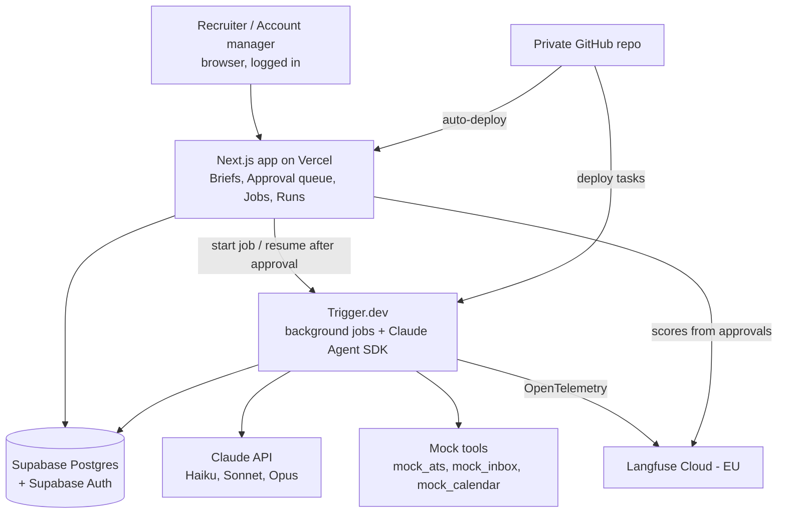

# Hosting plan: from local prototype to hosted demo

Use this file when the local prototype works and I want a shareable online version.
Do NOT start this during the prototype phases unless I explicitly ask.

## Goal
A hosted demo of the Hireloop recruiting agents that I can share by link,
with login, the same 9-step flow, the same approvals, and the same Langfuse tracing.
Tools stay mocked (seed data) unless I decide to connect real ones.

## Target architecture

## What changes, piece by piece
| Piece | Local prototype | Hosted | Effort |
|---|---|---|---|
| Code | Folder on laptop | Private GitHub repo | Easy |
| App | localhost | Vercel, auto-deploy from GitHub | Easy |
| Database | SQLite | Supabase Postgres | Easy if ORM was used |
| Login | None | Supabase Auth (email magic link) | Easy |
| Agent runner | Next.js server routes | Trigger.dev tasks | Medium |
| Approvals | `status` field polled by UI | Trigger.dev waits for approval, app resumes the job | Medium |
| Follow-ups, reminders, weekly job (corrections, dataset runs, summary) | Manual "run now" buttons | Trigger.dev scheduled / delayed tasks | Easy |
| Secrets | `.env.local` | Env vars in Vercel + Trigger.dev dashboards | Easy |
| Langfuse | Cloud EU | Same project, add `environment = hosted` tag | None |
| Mock tools | Seed data | Same, seeded into Postgres | Easy |

## Why Trigger.dev
- Hosted web requests have time limits; agent runs (e.g. screening 30 candidates) can take minutes.
- Approvals can take hours or days; Trigger.dev pauses a job and resumes it after the click.
- Delayed and scheduled work: follow-ups after 3 days, reminders 24h before interviews, weekly summary.
- Automatic retries if the Claude API or a tool fails briefly.
- Dashboard showing which jobs are running, waiting, or failed (Langfuse shows what the agent did and cost).
Alternative with the same role: Inngest. Overkill: Temporal.

## Accounts I'll need
- GitHub (private repo)
- Vercel (free tier is fine for a demo)
- Supabase (free tier, choose an EU region)
- Trigger.dev (free tier)
- Existing: Anthropic API key, Langfuse keys

## Migration steps (one at a time, confirm with me after each)
1. Push code to a private GitHub repo. Confirm `.env.local` is in `.gitignore`.
2. Supabase: create project (EU), switch ORM to Postgres, run migrations, load seed data.
3. Add login with Supabase Auth. Roles: recruiter, account_manager. Only invited emails can log in.
4. Trigger.dev: move each agent into a task. Approvals become wait/resume points.
   Move follow-ups, reminders, and weekly summary to scheduled/delayed tasks.
5. Vercel: connect the GitHub repo, add env vars, deploy.
6. Trigger.dev: add env vars, deploy tasks.
7. Langfuse: tag traces with `environment = hosted`; check cost budgets still work.
8. Smoke test: run one full job end to end on the hosted URL, check every acceptance
   criterion in `/specs`, and confirm traces + costs appear in Langfuse.

## Env vars (names only, never commit values)
- ANTHROPIC_API_KEY
- LANGFUSE_PUBLIC_KEY, LANGFUSE_SECRET_KEY, LANGFUSE_BASE_URL
- DATABASE_URL (Supabase)
- NEXT_PUBLIC_SUPABASE_URL, NEXT_PUBLIC_SUPABASE_ANON_KEY, SUPABASE_SERVICE_ROLE_KEY
- TRIGGER_SECRET_KEY

## Safety for a public URL
- Login required on every page; no public sign-up.
- Monthly spend limit set in the Anthropic Console.
- Job-level and per-agent cost budgets from the specs stay enforced.
- Only fictional seed data. No real candidate data without a GDPR review first.

## Done when
- [ ] I can share a link, someone logs in, and runs a full job from brief to scheduling
- [ ] Approvals pause and resume correctly, even a day later
- [ ] Follow-ups and reminders fire on their own
- [ ] Every run shows cost vs budget and links to its Langfuse trace
- [ ] No secrets in the GitHub repo

## First message to Claude Code when I'm ready
"Read docs/hosting.md, CLAUDE.md and /specs. Check the current code against the
'Keep it hosting-ready' rules, list anything that needs fixing first, then explain
migration step 1 in plain language and wait for my confirmation."
